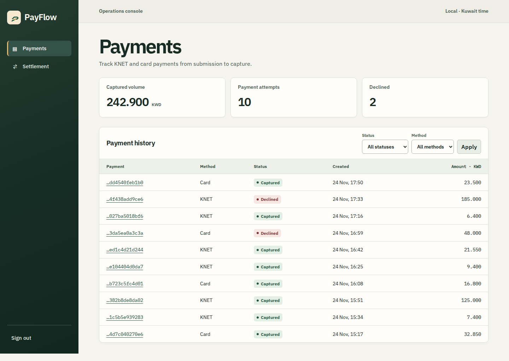

<p align="left"> <picture><source media="(prefers-color-scheme: dark)" srcset="public/brand/payflow-wordmark-light.png"></picture></p>

# PayFlow

I built PayFlow to trace a payment all the way from the merchant’s first request to the gateway statement. The Laravel app handles KNET and card payments, full and partial refunds, double-entry postings, and daily reconciliation in Kuwait time. The operator console links payment activity to settlement exceptions. A local MCP server gives Claude access to the same evidence through read-only tools.

I wanted a payment retry to be boring. The first request saves an operation and its outbox entry in MySQL. A Redis worker submits it with a stable provider reference. Confirmed changes and ledger postings commit together, and a refund reserves its share of the capture under a row lock. The local simulator makes declines, retries, and report discrepancies repeatable.

## Run it locally

Requirements are Docker with Compose v2 and PHP CLI for the setup script.

```sh
bash ops/setup.sh
```

Open [the operator console](http://localhost:8080) and sign in using `PAYFLOW_OPERATOR_PASSWORD` from your local `.env`. Setup generates that password and the merchant token, starts MySQL and Redis, and loads synthetic payments and a statement discrepancy. Leave `.env` out of source control.



[Payment detail](docs/screenshots/payment-detail.png) · [Settlement review](docs/screenshots/settlement.png) · [Mobile view](docs/screenshots/payments-mobile.png)

## Walk through a payment

```sh
source .env
curl -fsS http://localhost:8080/api/v1/payments \
  -H "Authorization: Bearer $PAYFLOW_MERCHANT_TOKEN" \
  -H 'Content-Type: application/json' \
  -H 'Idempotency-Key: walkthrough-knet-1' \
  -d '{"rail":"knet","amount":1250}'
```

Use the returned `status_url` with the same bearer token. Repeat the POST with the same key and body to see the same payment ID. On the simulator it should become `captured`. To try a refund, POST `{"amount":500}` to `/api/v1/payments/<id>/refunds` with a fresh idempotency key. The [API contract](docs/openapi.yaml) covers both routes. To replay a signed local callback, run `docker compose exec web php artisan payflow:deliver sim_<id>`.

Open **Settlement** to see a gateway statement disagree with a captured amount. The discrepancy links to its payment. The [incident walkthrough](docs/incident-walkthrough.md) uses those records to demonstrate the MCP tools.

## Architecture and verification

[System diagram and code map](docs/architecture.md) · [Tap sandbox smoke test](docs/tap-sandbox.md) · [Performance and verification](docs/verification.md)

Run the regression suite with `docker compose exec web php artisan test`. Run `bash ops/benchmark.sh` on a quiet simulator stack for the k6 concurrency and throughput checks. My five-minute run completed 14,973 requests with 212 ms p95 API acceptance. MySQL showed one provider record and one journal for each of the 11,979 distinct payments. The benchmark writes local reports under `artifacts/benchmark`.

The simulator, console, queues, and report storage run locally. The optional Tap and Claude walkthroughs use test data and their respective external services.
