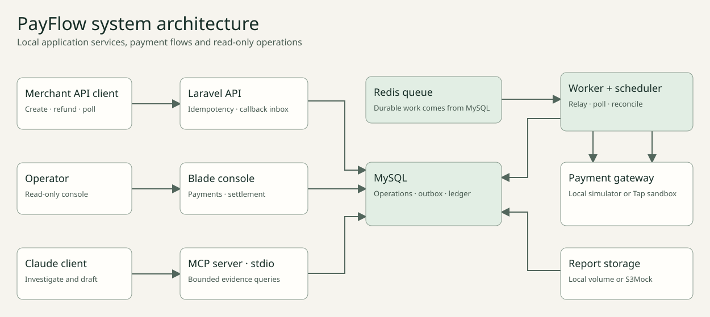
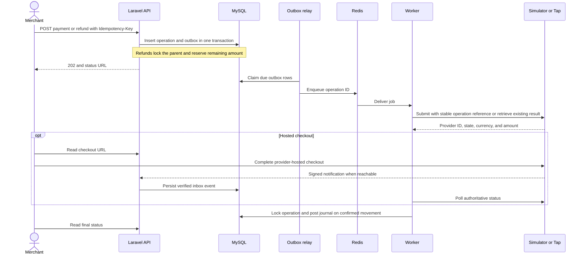
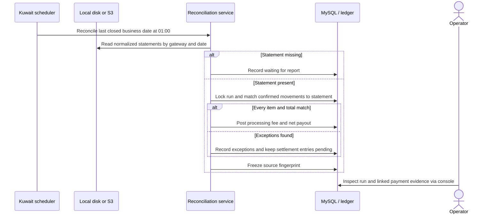

# How PayFlow fits together

[Open the editable architecture drawing](architecture.excalidraw) · [View the rendered diagram](architecture.svg)



MySQL owns payment state and the ledger. Redis moves work between processes. If a queue message goes missing, the outbox becomes eligible again. The provider call happens outside the database transaction, so another request never holds a payment row open while waiting on the gateway.

## Payment and refund



A captured charge debits gateway clearing and credits merchant payable. A confirmed refund reverses the corresponding amount. The application only inserts ledger postings, and each movement maps to a unique source journal. The model records the gateway payout into platform cash and leaves the merchant liability on the books.

## Settlement and reconciliation



Reports live under `reports/<gateway>/<YYYY-MM-DD>.json` on the configured disk. Fees, payout and signed movement amounts are all integer fils. Refunds are negative. Daily reconciliation uses the previous Kuwait calendar day. Import a delayed statement with `docker compose exec -T web php artisan payflow:import <date> --gateway=simulator < statement.json`. A frozen statement can be rerun with the same fingerprint. Amended statements require a separate accounting adjustment workflow.

```json
{
  "business_date": "2026-01-15",
  "currency": "KWD",
  "fee": 70,
  "payout": 1930,
  "items": [
    {"provider_id": "chg_example", "amount": 2500},
    {"provider_id": "ref_example", "amount": -500}
  ]
}
```

## Where the code lives

| Location | Responsibility |
| --- | --- |
| `routes/api.php`, `routes/web.php` | Merchant and webhook API, operator session and console |
| `app/PayFlow/` | Payment actions, provider adapters, outbox worker, ledger and reconciliation |
| `app/PayFlow/Mcp/`, `routes/ai.php` | Local stdio server and selected evidence queries |
| `database/migrations/`, `database/seeders/` | Constraints, composite indexes and synthetic incidents |
| `resources/views/`, `public/` | Console templates, brand assets, fonts and stylesheet |
| `ops/`, `tests/` | Local setup, smoke tests and performance verification |

For an AWS deployment, the web, worker and scheduler map to separate ECS task definitions, MySQL to RDS, Redis to ElastiCache and statement storage to S3. A real deployment would also need managed secrets, TLS, backup and restore drills, and a public callback ingress for Tap. This project tests the S3 storage interface with a local mock.
